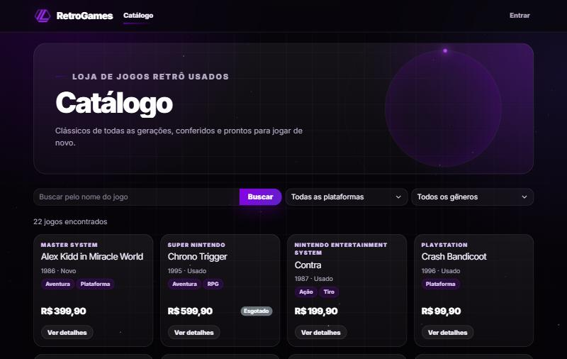
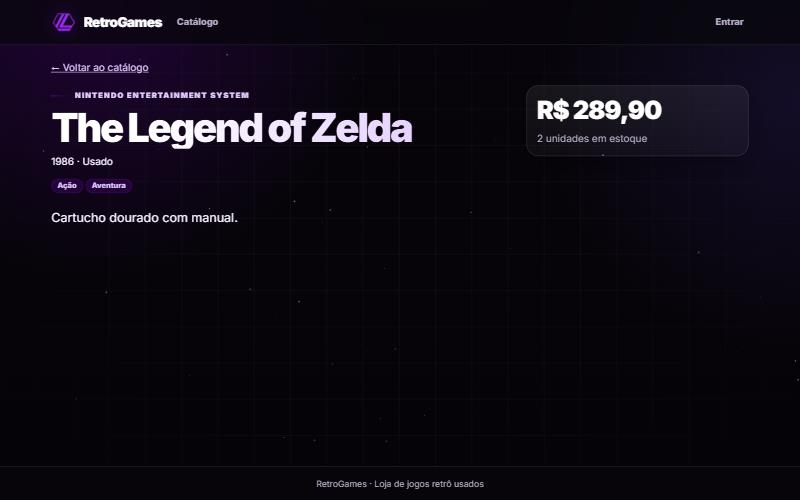
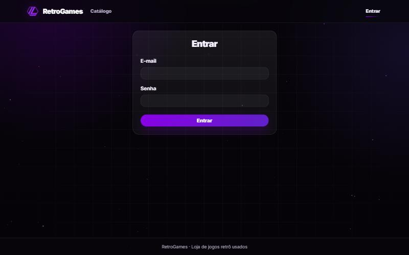
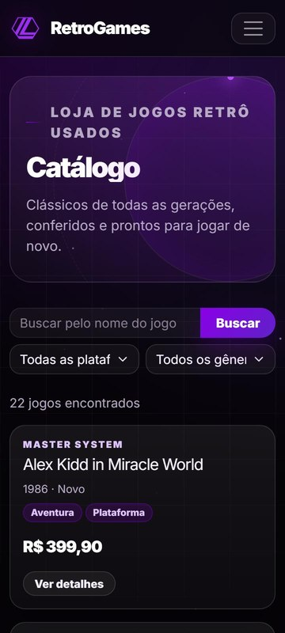
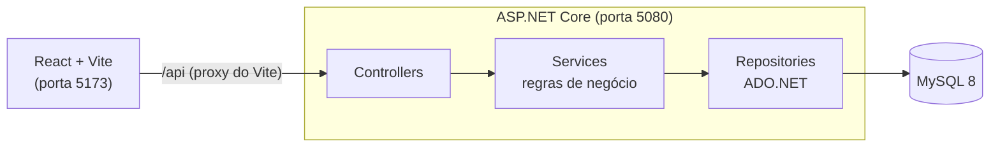

<div align="center">


# RetroGames

**Loja web de jogos retrô usados**: catálogo público e área de administração, com API em .NET e front-end em React.


</div>

---

## ✨ Como ficou

- Inspiração visual: https://luthorw.github.io/LuthorCorp/?lang=pt

<div align="center">



<sub>Catálogo com busca, filtros por plataforma e gênero (refletidos na URL) e paginação.</sub>

</div>

<table>
  <tr>
    <td width="50%" align="center">
      
      <br /><sub>Detalhe do jogo, com preço, estoque e gêneros</sub>
    </td>
    <td width="50%" align="center">
      
      <br /><sub>Login com retorno à página de origem</sub>
    </td>
  </tr>
</table>

<div align="center">
  
  <br /><sub>Responsivo: no celular o menu vira um botão e os cartões ficam em uma coluna</sub>
</div>

### Identidade visual

Tema escuro "cinematográfico", com fundo de estrelas animadas, grade sutil, cartões de vidro com brilho roxo, botões em pílula com degradê e a fonte Inter. As animações respeitam a preferência do sistema por menos movimento, e todo elemento clicável tem foco visível para quem navega pelo teclado.

---

## 🎮 Funcionalidades

**Visitante**
- Catálogo paginado com busca por nome e filtros por plataforma e gênero
- Detalhe de cada jogo, com indicação de **Esgotado**
- Jogos inativos não aparecem para o público

**Administrador**
- Login por e-mail e senha, com sessão em cookie `HttpOnly`
- Manutenção de **plataformas**: incluir, alterar e excluir
- Manutenção de **jogos**: incluir, alterar, desativar e reativar, com gêneros (N:N)
- Erros da API mostrados embaixo de cada campo do formulário

---

## 🏗️ Arquitetura



- **Controller → Service → Repository**, com um Repository por tabela e SQL sempre parametrizado
- A composição dos dados (plataforma, condição e gêneros de cada jogo) é feita no **Service com LINQ**, sem JOIN
- Gravações com mais de uma tabela ficam em **transação** (`TransactionScope`) no Service
- Toda resposta segue o envelope `{ responseCode, data, errorMessage }`
- Validação com **FluentValidation** e tratamento global de exceções

| Regra | Descrição |
| --- | --- |
| RN01 | Nome de plataforma único |
| RN02 | Plataforma com jogos não pode ser excluída |
| RN03 | Jogo nunca é apagado: é desativado (exclusão lógica) |
| RN04 | Jogos inativos só aparecem para o administrador |
| RN05 | Plataforma, condição e gêneros do jogo precisam existir |

---

## 🧰 Tecnologias

| Camada | Tecnologias |
| --- | --- |
| Back-end | .NET 10, ASP.NET Core (controllers), ADO.NET com MySqlConnector, FluentValidation, PasswordHasher, DotNetEnv, OpenAPI + Swagger UI |
| Banco de dados | MySQL 8 |
| Front-end | React 19, Vite, React Router 7, Axios, Bootstrap 5 |
| Testes | xUnit v3 e Moq |

---

## 🚀 Como executar

**Pré-requisitos:** .NET SDK 10, Node.js 22 LTS e MySQL 8.

1. **Banco de dados:** crie o banco no MySQL e execute, em ordem, os scripts da pasta `database/`:
   - `01 - Criar tabelas.sql`
   - `02 - Dados de exemplo.sql`
   - `03 - Consultas e testes.sql` é opcional: só confere os dados.

2. **Variáveis de ambiente:** copie `.env.example` para `.env`, na raiz do repositório, e preencha a connection string e o e-mail e a senha do administrador inicial. O `.env` está no `.gitignore` e nunca deve ser versionado.

3. **API**, na raiz do repositório:
   ```bash
   dotnet run --project RetroGames.WebApi
   ```
   A API responde em `http://localhost:5080`, e o Swagger fica em `http://localhost:5080/swagger`.

4. **Front-end**, em outro terminal:
   ```bash
   cd retrogames.web
   npm install
   npm run dev
   ```
   Acesse `http://localhost:5173`.

---

## 🧪 Testes

```bash
dotnet test RetroGames.sln
```

São **16 testes unitários** dos Services, sem banco de dados: os repositórios são simulados com Moq.

| Classe | O que comprova |
| --- | --- |
| `PlataformaServiceTests` | RN01 (nome duplicado, inclusive pelo banco), RN02, plataforma não encontrada e o caminho que dá certo |
| `JogoServiceTests` | Plataforma, condição e gênero inexistentes, filtro por gênero, montagem com LINQ, busca e desativação |
| `GeneroServiceTests` e `CondicaoJogoServiceTests` | Listagens |

---

## 📁 Estrutura

```
RetroGames/
├── database/                      # scripts SQL (tabelas, dados e consultas)
├── RetroGames.Model/              # entidades e constantes
├── RetroGames.Repository/         # acesso ao MySQL (um repositório por tabela)
├── RetroGames.Services/           # regras de negócio
├── RetroGames.WebApi/             # controllers, validação, autenticação
├── RetroGames.WebApi.ApiModels/   # modelos de requisição e resposta
├── RetroGames.WebApi.UnitTests/   # testes unitários (xUnit + Moq)
└── retrogames.web/                # front-end React
```

---

<div align="center">

Projeto acadêmico desenvolvido por **[LuthorW](https://github.com/LuthorW)** 💜

</div>
